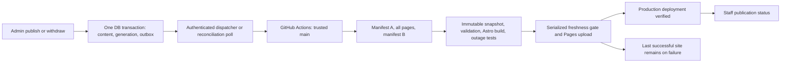

# ADR: durable publication to a static resident website

Status: architecture accepted by team lead on 2026-10-16; implementation and remote setup pending. CP-Architect owns this document. API-Dev owns backend implementation; Web-Dev owns the consumer and CMS. This decision does not authorize production migrations, content imports, credentials, infrastructure changes, or deployment.

Security review is a separate mandatory production rollout checkpoint. CP-Security owns [the independent security report](security-review.md); acceptance of this architecture is not security approval. Before provisioning credentials/infrastructure, applying hosted migrations, approving bootstrap or deploying, the lead must review that report and verify closure or explicit disposition of its rollout findings. Local implementation and disposable tests may continue subject to any reported local blockers. CP-Architect resolves confirmed design findings here; developers retain ownership of code fixes and CP-Security retains ownership of the report.

## Decision and present blockers

Keep Astro resident output static on the existing Cloudflare Pages Direct Upload project. A committed database publication event requests a build through a durable outbox. A trusted GitHub Actions workflow exports one consistent content generation, validates an immutable snapshot, builds and tests the site, then uploads the exact validated artifact through one serialized production deployment authority. Supabase or pipeline outages leave the last successful Pages deployment serving residents.

The immediate blockers are an additive API contract, reviewed bootstrap publication, a deployment workflow, scoped machine credentials, and artifact/status infrastructure. The frozen v1 API remains intact. Its paginated reads alone cannot establish a consistent concurrent export. Production `PUBLIC_CONTENT_SOURCE=supabase` stays gated until the contract below is available, or the lead explicitly selects the supervised freeze procedure below. The independent CMS can ship now.

Read-only evidence on 2026-10-16:

- Web origin is `https://github.com/CivicPulse/civicpulse-web.git`; GitHub reports a public, unarchived repository with default branch `main`. The current CLI identity has administration permission; this is not a runner credential.
- Actions are enabled with `allowed_actions=all`, `sha_pinning_required=false`. There is no deployment workflow: the only returned workflow is GitHub's dynamic Copilot code review. Neither checkout has a `.github` directory. Repository Actions secrets and environments both return zero. Organization secret availability and runner execution/billing were not established.
- Web README identifies Direct Upload project `civicpulse-web`, production branch `main`, account `6d837580a4d0641139ecada9e74076b8`, and `https://www.civpulse.org/`. Git pushes do not currently deploy. No remote configuration was changed during this review.
- API handoff/verification records deployed v1, no initial hosted content import, no rebuild endpoint, and no generation/inventory/status contract. API-Dev confirms history is an audit trail, not a delivery queue.
- Read both projects' PRODUCT/README files, web DESIGN.md, API `docs/api.md`, `docs/web-integration-handoff.md`, and `docs/verification.md`. This decision supersedes the handoff's runtime-content option for core resident functionality.

GitHub Actions is the selected external runner. Direct Upload accepts prebuilt assets; changing this project to Git integration requires a new Pages project. A Pages Deploy Hook assumes a repository build branch and is a bearer secret, so it is not the chosen trigger. See [Direct Upload](https://developers.cloudflare.com/pages/get-started/direct-upload/), [CI deployment](https://developers.cloudflare.com/pages/how-to/use-direct-upload-with-continuous-integration/), and [Deploy Hooks](https://developers.cloudflare.com/pages/configuration/deploy-hooks/).

## Delivery boundary



All resident content, map catalogs, layer GeoJSON, search/filter data, calendars and ICS downloads must resolve from the deployed static artifact. Self-host required scripts/fonts. Optional map tiles may fail without disabling layers, controls or the directory. New browser API enhancements require an immediately usable static fallback, bounded timeout, accessible error state and no replacement of good data by an error/empty response. Admin/Auth may depend on Supabase. This promises independence from Supabase/API outages, not availability during a Cloudflare or visitor-network outage.

## Additive backend contract: canonical v1 proposal

These are new interfaces for API-Dev to implement locally after handoff. Existing `publish`, `withdraw`, content and GeoJSON signatures do not change. All bigint values below cross JSON as decimal **strings**, avoiding JavaScript precision loss. IDs are `(kind,id)` tuples, never `id` alone. Kinds are exactly `organization`, `calendar`, `event`, `layer`, `map`.

### Publication generation and events

Maintain a private singleton publication state `{dataset_epoch: uuid, generation: bigint, bootstrap_complete: boolean}`. API migrations initialize a fresh epoch, generation 0 and bootstrap false. Every successful published-state mutation acquires the existing catalog transaction lock, advances the singleton generation with a transactional row UPDATE, and inserts one logged outbox event in the same transaction as content/features/history. Draft saves do not advance it. No network call participates in that transaction. Direct published-table writes remain denied; approved maintenance must use the same mechanism.

Do not use `max(history.sequence)`, timestamps, or a standalone sequence allocation as the committed generation. The locked counter and content become visible together. An exact repeated publish with no public change may return the existing v1 result without a new event; any observable public change must advance generation. Withdraw failure/transaction rollback produces no event. Publication failure to append its durable event must roll back publication.

An outbox event has this shape (private actor/error fields are omitted):

```json
{
  "schema_version": 1,
  "event_id": "UUID",
  "dataset_epoch": "UUID",
  "generation": "42",
  "action": "publish",
  "kind": "event",
  "id": "source-event-id",
  "revision": "3",
  "occurred_at": "2026-10-16T20:00:00Z"
}
```

`action` is `publish|withdraw|bootstrap`. For bootstrap, kind/id/revision are null. For withdraw, revision is the removed published revision; the event is a durable tombstone. Unique `(dataset_epoch,generation)` and unique `event_id` enforce deduplication. Operational columns separately track dispatch attempts, next attempt, receipt/run IDs and delivery state. Events retain their identity on retries. Multiple publications can be represented by one later complete deployment; retain their individual audit outcomes.

The epoch changes only during an operator-controlled restore/reseed/cutover, under the publication lock, with automation paused. A database restore can rewind the epoch too: the restore runbook MUST assign a fresh epoch before resuming writes/automation. A differing epoch is never numerically compared with the previous one and never automatically accepted by production. Lead/operations approve its bootstrap and establish a new deployment baseline. API-Dev supplies the guarded maintenance operation; CMS users and runners cannot reset epoch or bootstrap state.

### Atomic inventory

Add `public.publication_manifest()` with POST body `{}` and public read access to published metadata only. Return one JSON object from one SQL statement snapshot (or an explicitly equivalent single database snapshot), not a series of independent queries. No drafts, actors, secrets or private job state are included.

```json
{
  "schema_version": 1,
  "dataset_epoch": "UUID",
  "generation": "42",
  "bootstrap_complete": true,
  "counts": {"organization": 1, "calendar": 1, "event": 0, "layer": 1, "map": 1},
  "records": [
    {"kind": "calendar", "id": "c", "revision": "1"},
    {"kind": "layer", "id": "l", "revision": "2"},
    {"kind": "map", "id": "m", "revision": "1"},
    {"kind": "organization", "id": "o", "revision": "1"}
  ],
  "layers": [{"id": "l", "revision": "2", "mode": "stored", "feature_count": 12}]
}
```

All five counts are mandatory nonnegative integers. `records` is the exhaustive published inventory, sorted by kind then id using documented bytewise/C collation. `layers` is exhaustive for published layers, sorted by id; `mode` is `stored|events`. Stored feature count is the exact exported count. Event-derived count is the number of published events meeting the API's documented coordinate eligibility predicate, before web venue grouping. Counts are not fixed minimums. There are no timestamps in this manifest that change between equivalent reads.

Manifest equality means exact equality of schema_version, epoch, generation, bootstrap flag, every count, sorted inventory tuple and layer tuple. Object property order is irrelevant; compare validated normalized values and hash a specified stable-key serialization for storage. Do not compare raw JSON strings from HTTP. No manifest pagination in this initial small-catalog contract; if limits require pagination, return an immutable manifest artifact/token in a future version rather than silently truncating it.

Successful omissions relative to a previous complete inventory mean removal. Staff audit/outbox tombstones explain those omissions; they need not expose withdrawn IDs in the public manifest. Missing fields, malformed lists, missing expected records or mismatching feature counts are failure, never removal. `bootstrap_complete=false` always blocks automated production activation, even if reads succeed.

### Authenticated runner and operational RPCs

Use a dedicated machine identity with an expiring credential and a private role registry, independent of CMS staff roles. Choose a dedicated Postgres login over verified TLS/session connection for the first runner implementation. It receives CONNECT, schema USAGE and EXECUTE on fixed `civicpulse_delivery` functions only; no direct table, draft, membership, content-write or general service-role access. Functions perform explicit machine-role checks, fixed search paths and narrow internal writes; revoke PUBLIC execution. Distinct roles are `dispatcher` and `runner`. SQL function JSON results use the shapes below; they are not exposed as public PostgREST runner endpoints. API-Dev tests privileges with real database roles.

| Function and arguments | Result and rule |
| --- | --- |
| `civicpulse_delivery.claim_dispatch(p_worker_id text, p_limit integer)` | Leased event receipts `{event, dispatch_lease_id, lease_expires_at, attempt}`; dispatcher only; bounded batch |
| `civicpulse_delivery.finish_dispatch(p_event_id uuid, p_dispatch_lease_id uuid, p_outcome text, p_run_id text, p_error_code text)` | `{accepted:boolean,next_attempt_at:timestamp|null}`; outcome `accepted|retry|failed`; lease CAS; accepted means CI accepted the request, not live |
| `civicpulse_delivery.claim_build(p_run_id text, p_source_sha text)` | null if no work, otherwise `{job_id,lease_id,fence,dataset_epoch,target_generation,lease_expires_at}`; reads latest desired generation, not dispatch input; creates at most one active production job |
| `civicpulse_delivery.heartbeat_build(p_job_id uuid,p_lease_id uuid,p_fence bigint)` | `{lease_expires_at}` or conflict; runner only |
| `civicpulse_delivery.transition_build(p_job_id uuid,p_lease_id uuid,p_fence bigint,p_expected_state text,p_state text,p_evidence jsonb)` | `{state}`; CAS and legal-transition validation; evidence allowlist described below |
| `civicpulse_delivery.begin_deploy(p_job_id uuid,p_lease_id uuid,p_fence bigint,p_epoch uuid,p_generation bigint,p_manifest_sha256 text,p_artifact_sha256 text,p_source_sha text)` | `{attempt_id,authorized:true}` or conflict; latest-generation and baseline checks, records deploy intent before network call |
| `civicpulse_delivery.finish_deploy(p_attempt_id uuid,p_fence bigint,p_deployment_id text,p_outcome text,p_observation jsonb)` | `{state,live_generation,live_deployment_id}`; only verified success advances live; outcome `live|failed|unknown` |
| `public.cms_publication_status()` body `{}` | Staff only; shape below, no machine secrets/error bodies |
| `public.cms_record_publication_status(p_kind text,p_id text)` | Staff only; `{last_event_id,last_action,last_generation,published_revision,live_revision,website_state}`; nulls allowed; avoids changing v1 write returns |

`fence` is an increasing job-owner token. Lease defaults: 5 minutes, heartbeat every minute. Heartbeats/retries do not overwrite a newer owner's state. `claim_build` may reclaim an expired pre-deployment job after confirming its CI run stopped; it must never reclaim a `deploying|deployment_unknown` job solely because time elapsed. Evidence includes artifact/manifest hashes, snapshot path, run URL, preview deployment ID, sanitized error code and timestamps. URLs/SHAs are validated; arbitrary SQL, callback URLs and secret-bearing logs are forbidden. Implementations may use typed SQL parameters internally while preserving these external JSON shapes.

Canonical SQL errors are `42501` for unauthorized role, `22023` for malformed input, `40001` for stale epoch/generation/fence/state or concurrent claim conflict, and `55000` for a paused pipeline, unapproved bootstrap/epoch, or unresolved deployment. No-work `claim_build` returns JSON null, not an error. Functions must not return connection strings, tokens or raw provider error bodies. Dispatch lease defaults to two minutes; accept batch limits 1–100. Use the database clock for leases/backoff.

### Maintenance, recovery and claim precision

Add a third private machine capability `reconciler`, allowed only to observe provider outcomes and recover jobs, and an operator-only capability `publication_operator`. Neither is CMS admin or the ordinary dispatcher/runner. In the first deployment the reconciler may run as a separate protected job within the same trusted workflow; its separate DB credential has no content-write, epoch/bootstrap or production-upload capability. The privileged operator credential is never provided to automatic CI.

| Guarded SQL function | Result and required checks |
| --- | --- |
| `civicpulse_delivery.approve_bootstrap(p_expected_epoch uuid,p_expected_generation bigint,p_expected_manifest jsonb,p_review_reference text)` | Operator only; under catalog lock compare the complete normalized manifest supplied by the reviewer with current inventory and require bootstrap false. Set bootstrap true, increment generation and append bootstrap event atomically. Return `{dataset_epoch,generation,event_id,bootstrap_complete:true}`. The approved resulting snapshot uses the returned generation, not the preapproval one. Stale inventory fails `40001`; review reference is required. |
| `civicpulse_delivery.reset_epoch(p_expected_epoch uuid,p_new_epoch uuid,p_review_reference text)` | Operator only; require pipeline paused and no unresolved/in-flight deployment. Under catalog lock compare old epoch, require a distinct never-used new UUID, set generation 0/bootstrap false and clear active baseline authorization. Keep previous live receipts/history in an epoch-qualified archive; do not overwrite served-live evidence with null. Return `{dataset_epoch,generation:"0",bootstrap_complete:false}`. This operation does not deploy or delete content. |
| `civicpulse_delivery.set_pipeline_paused(p_paused boolean,p_review_reference text)` | Operator only; return `{paused:boolean}`. Pausing blocks new claims/deploy begins but does not cancel an in-flight upload or erase its gate. Resume only after outstanding unknown outcomes and epoch baseline approval are resolved. |
| `civicpulse_delivery.approve_epoch_baseline(p_expected_epoch uuid,p_live_deployment_id text,p_live_marker jsonb,p_review_reference text)` | Operator only; bootstrap complete, pipeline paused, no in-flight/unknown upload, observed existing production deployment and marker supplied from a verified read. Establish permitted current epoch and record previous live epoch/generation without pretending new content is live. Return `{approved_epoch,previous_live_deployment_id}`. Required at first automation cutover and after reset. |
| `civicpulse_delivery.reconcile_job(p_job_id uuid,p_fence bigint,p_observation jsonb)` | Reconciler only; compare current fence and stored run/attempt identities. Predeploy recovery requires expired lease and GitHub run status `completed`; archive old job as failed/superseded and make desired work claimable with a new fence/job. Deploy recovery additionally requires known terminal Pages outcome plus production marker. Return `{state,reclaimable:boolean,live_generation}`; ambiguous evidence keeps lockout. |

`p_observation` has validated keys `{checked_at,github_repository,github_run_id,github_run_attempt,github_status,github_conclusion,pages_deployment_id,pages_status,production_marker}`; provider fields can be null only for predeployment recovery. The reconciler fetches GitHub/Cloudflare directly over authenticated APIs using fixed repository/project IDs, not URLs supplied by a failed job. It then submits the observation. PostgreSQL trusts that narrowly authorized reconciler's attestation; it cannot independently prove a GitHub job stopped. Local tests assert role isolation and reject wrong run IDs, stale observations (older than two minutes), active CI states, mismatching attempts/fences and nonterminal Pages outcomes. Missing/contradictory evidence requires operator investigation, not a fabricated success. A stopped run with an unresolved upload remains blocked.

`claim_build` locks delivery state and chooses the latest desired generation at claim time, pinning `(epoch,target_generation,source_sha)` for the whole job. If a later manifest differs, mark this job superseded and make a **new** claim; never change the target of an active job. It returns null only when bootstrap/baseline are ready, no active/unknown work exists, and both desired generation and the trusted resolved source SHA equal verified live values. If content generation equals live but source SHA differs, create a source-only release with a new job/fence. If a compatible active claim exists, a duplicate call with the same run ID/source SHA returns that claim; a different run cannot steal it. Run identity includes GitHub run ID and run attempt. The runner/reconciler resolve trusted main SHA; ordinary dispatch input does not set it.

Ordinary claims do not themselves assert that another CI job stopped. Recovery is a separate reconciler operation before a new claim, and is prohibited after deploy intent until reconciliation resolves the external operation. A successful release records exact live inventory (or a verified immutable manifest reference) for staff per-record status. Epoch-qualified previous-live fields remain available when the approved desired epoch differs from the currently served epoch; simple numeric lag is null across epochs. Source-only and intentional all-empty release approval evidence must be bound to the job's source/manifest identity; operator-reviewed all-empty approvals are retained in the job evidence and cannot be self-issued by a runner.

States: `queued -> exporting -> building -> validating -> ready -> deploying -> live`. Before deploy, `superseded` or `failed` may terminate an attempt. Transient failures retain desired work with `next_attempt_at`. `deploying -> failed` requires a known terminal Pages failure; timeout/crash becomes `deployment_unknown`, blocking later production writes until reconciliation. Retry creates a new attempt/job referencing the same desired generation; it does not pretend a previous attempt succeeded. A newer desired generation supersedes obsolete queued/building work without discarding its audit history.

```json
{
  "dataset_epoch": "UUID",
  "desired_generation": "44",
  "live_generation": "42",
  "live_deployment_id": "pages-id",
  "live_source_sha": "git-sha",
  "live_at": "2026-10-16T20:03:00Z",
  "state": "building",
  "active_job": {"job_id": "UUID", "generation": "44", "run_url": "https://github.com/..."},
  "last_error": null,
  "next_attempt_at": null,
  "observed_at": "2026-10-16T20:04:00Z"
}
```

Status may have null live fields before first CMS deployment. Source-only releases at the same content generation are permitted with a new approved source SHA and monotonically increasing release/fence identity. Production must never regress source SHA because an older queued workflow started later: resolve approved `main` HEAD when claiming and recheck before deployment. Explicit rollback is a separate audited operator action.

## Trigger, authentication, retries and coalescing

The database outbox insertion is the durable trigger. The first working delivery path is an authenticated scheduled/manual GitHub workflow that polls pending desired work. Add a five-minute reconciliation schedule at non-hour-boundary minutes and `workflow_dispatch` on trusted `main`. This is sufficient for eventual delivery without a new public webhook. GitHub schedules can be delayed/dropped, so no hard five-minute freshness guarantee is promised. See [GitHub scheduled-workflow limitations](https://docs.github.com/en/actions/how-tos/troubleshoot-workflows).

For prompt updates, add a server-side dispatcher (API-Dev; scheduled Supabase Edge Function/Cron after setup approval). It leases committed outbox events and calls the fixed web workflow's authenticated `workflow_dispatch` API on `main`. Use a repository-restricted GitHub App installation token with Actions write (or a scoped, expiring fine-grained token initially). Never put that token, a deploy hook URL or Pages credential in CMS/browser code. The dispatcher authenticates to the private queue with its own narrow DB role; its scheduling endpoint requires a server-held secret. Do not disable endpoint authentication. See [GitHub workflow dispatch permissions](https://docs.github.com/en/rest/actions/workflows#create-a-workflow-dispatch-event).

Dispatch input is `{event_id,dataset_epoch,generation}` as an advisory wake-up. GitHub authenticates the caller; the workflow ignores it as content/source authority and reads actual database desired state. Duplicate, forged-with-stolen-token, late or out-of-order signals cannot select a branch, artifact, arbitrary command or older generation. A lost dispatch response is retried with the same event ID; multiple CI runs are safe. Accepted dispatch does not remove durable pending publication. Periodic reconciliation compares desired and verified live state independently of dispatch flags and repairs a missing/stalled run.

Coalesce to the newest committed generation after a 30-second quiet window, with a two-minute maximum debounce. These are application defaults, not provider guarantees. Retries use exponential backoff with jitter (30 seconds, 2 minutes, 10 minutes, then hourly); honor provider Retry-After. After five consecutive failures alert and mark intervention required, while retaining the event and allowing hourly health reconciliation/manual retry. Authentication/schema/validation failures alert immediately and do not run a rapid retry loop. Retry the newest desired generation when an old candidate is superseded.

Supabase Database Webhooks use asynchronous pg_net; its request/response queues are unlogged and responses expire. They may accelerate delivery but cannot replace our durable logged outbox. Supabase Queues is another possible transport, but would still need publication generation, status and deduplication logic; a logged outbox avoids an additional queue product here. See [Database Webhooks](https://supabase.com/docs/guides/database/webhooks), [pg_net durability](https://supabase.com/docs/guides/database/extensions/pg_net), and [Supabase Queues](https://supabase.com/docs/guides/queues).

## Consistent export and explicit removal

1. Read manifest A from the authoritative primary with caches bypassed. Require supported schema, expected epoch and bootstrap complete. Claim/correlate its generation. Do not use a replica or HTTP cache that may return independently stale responses.
2. Fetch all five kinds with explicit `order=kind.asc,id.asc` and page size 100. Validate response shape, unique `(kind,id)`, matching payload ID and revision, exact membership/count against A. Continue until every expected record is received; a short page alone never proves completeness. Reject duplicates, missing records, extra records and non-advancing pagination.
3. Fetch each stored layer with fixed page size 500, no viewport bounds. v1 SQL orders features by `id,ordinal`; require documented stable ordering and an explicit `nextOffset:null` terminator. Missing/invalid `nextOffset`, duplicate export identities or incorrect count fail. Preserve source IDs/properties even if upstream feature IDs repeat: use the API ordering ordinal internally for identity, not a blanket unique source-ID requirement. Derive event-location geometry from the same captured event records, using a versioned transformation; compare the pre-group eligible-event count, then record output venue count separately.
4. Read manifest B after all responses complete. Require canonical A=B. If generation changes, discard the entire candidate and retry from A, at most three immediate export attempts with jitter; then leave pending and retry later. Never append new pages to old pages. A stable epoch/generation surrounding uncached primary reads, together with the invariant that every public mutation changes that generation, establishes one consistent state. This is an application proof, not a claim that separate v1 HTTP requests share a transaction.
5. Validate references, geometry, source/provenance, event timezone/date rules, sanitized rendering and exact inventory. Record per-file SHA-256, byte size, record/feature count, exporter version, source SHA, API vendor manifest hash, epoch and generation in the immutable snapshot manifest. All paths must remain inside the snapshot root; hash or safely encode IDs for filenames.

A kind with count zero and no inventory members is deliberately empty and renders an accessible empty state. A zero-feature layer is likewise allowed if its inventory says zero. Remove withdrawn records from every current catalog, map, search index, ICS and source/download route owned by CMS. Never merge missing CMS records back from legacy local data. Public omission does not require a browser to download tombstones.

During bootstrap, an empty uninitialized API never replaces the reviewed local site. After bootstrap, empty kinds are valid. A transition to a completely empty catalog requires an explicit operator-reviewed empty-site release approval bound to epoch, generation and manifest hash; validate that the site shell and empty states still function. Large count drops generate review evidence; fixed historical minimum counts must not make legitimate withdrawals impossible.

For v1 only, production snapshot mode is disabled by default. An exceptional supervised export requires the lead to record a publication freeze covering **all** publication writers/maintenance, capture an independently reviewed exhaustive inventory and feature counts under that freeze, export/validate, and approve its manifest. Prefer an operator-held existing catalog advisory lock with a controlled connection while readers export; release reliably in finally/connection teardown. If enforcing the freeze is unavailable, abort. Repeated matching v1 reads or a CMS banner alone are not a consistency guarantee. No automatic pipeline advertises this as generation-safe. Do not retain the freeze for a long build/deploy; subsequent edits remain pending for the next supervised release.

## Atomic local activation and build requirements

Web-Dev must replace writes to shared `public/data/cms` followed by `src/data/cms-published.json` with a single immutable snapshot directory. Example: `.civicpulse/snapshots/<epoch>-<generation>-<manifest-hash>/` contains `records.json`, `layers/`, and `manifest.json`. Write first to a unique sibling staging directory on the same filesystem. Validate every file and write the manifest last; rename the complete directory into its final immutable name. Never rename separate files as the activation transaction.

The build receives `CIVICPULSE_SNAPSHOT_DIR` identifying that exact verified directory and resolves it once. If developer convenience needs a current pointer, atomically rename a small pointer file only after the snapshot is complete; builds pin its resolved target for their entire lifetime. Failure leaves the old pointer untouched and removes only the failed attempt's staging directory. Crash leftovers are not considered candidates. Cleanup must not remove any active/pinned/retained generation.

Build in a fresh isolated checkout/output directory. Copy only manifest-listed CMS assets into a fresh `dist`; never reuse old dist or glob an old CMS directory. If adapters require source-shaped files, materialize them in the isolated build workspace from the pinned snapshot, not in a shared developer checkout. Publish the static marker `/publication.json` with schema version, epoch, generation, source SHA and manifest hash; set it to revalidate/no-cache. It contains no private job details.

In `PUBLIC_CONTENT_SOURCE=supabase`, missing config/manifest, network/permission failure, parse error, incomplete fetch, generation race or failed validation exits nonzero. Do not catch these errors and return local data. Local source remains a separately selected, honest `local` mode until cutover. A retained snapshot may support an explicit recovery release, but must retain its original generation/capture time and never be reported as newly fetched or current.

Continue vendoring `client.mjs`, generated `database.types.ts` and checksum manifest from a pinned API commit into `src/vendor/civicpulse-api/`. No sibling repo imports in shipping builds. Generate/update types for the additive public manifest/status functions; keep runner credentials/types in server-only tooling. Public reads need only the publishable key. CMS uses a single authenticated Supabase client and database-enforced staff authorization; no deployment secret uses a `PUBLIC_` name.

Node 22.12+ and `npm ci` from the committed lockfile are required. Pin workflow actions by full commit SHA and tool/dependency versions in the lockfile. Run `npm run build`, snapshot validators and relevant browser suites against the built output; block Supabase/API requests in browser tests. Require desktop/mobile map interaction, calendar/search, ICS, data/source links and empty-state checks with API unreachable. Preserve DESIGN.md controls, focus visibility and status announcements.

## Production serialization, freshness and Pages activation

Create a proposed GitHub environment `production` restricted to trusted `main`. Automatic content updates should run after database admin publication without another human approval per build; lead decides environment protection/setup once implementation is reviewable. Production secrets are environment-scoped. Fork/PR/untrusted branches receive no production credentials, cannot dispatch arbitrary commands and cannot upload production. PR validation uses fixtures and read-only permissions. A production job checks out the resolved trusted `main` SHA, never a dispatch-supplied ref or pull-request head. Workflow token defaults to `contents:read`; add permissions only for features actually used. Protect workflow/source changes through repository review policy before enabling secrets; this protection does not exist yet.

Every production path (content, source push, manual rebuild, recovery and rollback) uses the same repository-wide concurrency group `civicpulse-pages-production` with `cancel-in-progress:false`, and the same DB deployment gate. Do not use a branch-specific group. The outbox is the durable queue; Actions pending-run replacement/order is not relied on. Manual local `npm run deploy` and dashboard uploads must be retired from routine operation or explicitly coordinated under the same gate as a break-glass exception. One independently privileged uploader defeats ordering guarantees. See [Actions concurrency](https://docs.github.com/en/actions/how-tos/write-workflows/choose-when-workflows-run/control-workflow-concurrency).

After local validation, upload a preview if configured and test the unique preview URL. Keep the tested artifact byte-for-byte immutable. Preview is not production: deploy those same bytes to production `main`; do not run a second build during promotion or assume a Pages preview can be promoted through rollback. The Pages rollback API supports successful production deployments, not previews. See [preview deployments](https://developers.cloudflare.com/pages/configuration/preview-deployments/) and [rollbacks](https://developers.cloudflare.com/pages/configuration/rollbacks/).

Immediately before production upload, `begin_deploy` atomically checks ownership/fence, ready state, approved epoch, manifest/artifact/source hashes, current desired generation equal to candidate, no unknown deployment and no newer verified live release. Also recheck trusted main HEAD; discard/requeue superseded source/content. If the database cannot be reached, do not start a new content deployment. Record attempt intent, then invoke the pinned Wrangler `pages deploy` with explicit project `civicpulse-web`, branch `main`, account and exact artifact path. Do not invoke a convenience command that rebuilds it.

Hold exclusive production authority until Cloudflare reports terminal status and the production domain's `/publication.json` matches the attempt. Then commit verified deployment ID, generation, artifact digest and timestamp. A successful upload response alone is not enough. Persist a receipt independently in the artifact store/CI so an API outage after upload can be reconciled. If success cannot be established, record unknown and stop subsequent uploads until Pages deployment history and the public marker establish the outcome. Do not treat timeout as proof of failure or automatically release the gate when a lease expires.

A fencing token protects database state, but Cloudflare Pages does not consume our token as a conditional deployment write. Therefore a DB lease alone cannot fence a paused uploader. Never launch a replacement while an old uploader may still run; confirm its CI job stopped and any in-flight Pages operation is terminal before recovering. If that cannot be proved, require operator resolution. This is why the sole uploader and shared concurrency group are requirements, not optional optimizations.

A new publication can commit after the predeploy check while a valid upload is in flight. That generation remains pending and is deployed next; the completed artifact still represents a coherent earlier generation. We guarantee no older release overwrites a newer verified release, not instantaneous equality with a continuously changing database. Suppressing every intermediate generation would require holding a publication lock across network deployment and is deliberately not selected.

Pages receives complete deployments, not incremental edits to live files. A pre-upload export/build/test failure makes no production write. On a known failed upload retain the previous successful production deployment. Verify this behavior with injected failure on a nonproduction project before enabling automation. Cloudflare documents immutable atomic preview deployments and prior-production rollback; test the actual production failure path rather than treating the wording as an untested SLA. Multi-request browsers may span release changes, so use versioned CMS asset URLs and handle unavailable old assets gracefully; do not promise a transaction across all browser requests.

## Recovery, retention and withdrawal consequences

Retain the current and previous successful snapshot plus exact dist artifact, hashes, source SHA and deployment receipts in a **private dedicated artifact bucket** (proposed R2 bucket `civicpulse-build-artifacts`, not the public PDF bucket). Initial retention target: 30 days and at least the last two successful releases. Preserve the current last-known-good release regardless of age. Stage failure artifacts/logs separately with a shorter retention. Upload credentials cannot make the bucket public. A stored snapshot alone is not a proven build artifact; preserve both. Snapshot/build validation precedes marking an artifact successful.

| Failure | Required recovery |
| --- | --- |
| Dispatcher/dispatch response lost | Retry same event ID; reconciler finds desired > live independently |
| API unavailable before/during export | Abort candidate; old Pages site serves; retry after recovery |
| Later layer fetch or validation fails | Discard entire staging generation; active pointer/artifact untouched |
| Build/test fails | No production upload; expose failed attempt and next retry; fix code/data |
| New publish during export/build | Restart unstable export or supersede stale candidate at freshness gate |
| Cloudflare upload known failed | Keep prior deployment; retry validated artifact only if still current |
| Timeout/crash after deploy intent | Block further upload; inspect CI, Pages status and marker; reconcile |
| Live succeeded, status callback failed | Recover receipt/marker; idempotently acknowledge, never blindly redeploy |
| Runner/DB restore | Pause, rotate epoch if restored state, reconcile baseline before resuming |
| Broken release discovered after success | Pause automated promotion; review rollback target or fix-forward; use same exclusive authority |

Rollback can resurrect withdrawn records. Prefer rebuilding corrected source against the latest verified content snapshot. An older artifact rollback requires operator review of tombstones/removals since that artifact, an audit entry and truthful status showing the regressed live generation. Never automatically roll back content solely because Supabase is offline. During an outage, retain the already live site; a pending withdrawal remains visible there until deployment succeeds. CMS must say so.

Withdrawing from the current website does not erase prior preview/production deployment URLs, external caches, downloaded ICS/PDFs, or archived artifacts. For urgent takedown, use a separate authorized operator process to restrict/remove historical deployments and purge relevant caches, review artifact retention, and deploy a reviewed minimal static removal artifact if necessary. Removal URLs in the current artifact must return appropriate 404/410 or a safe redirect, not legacy copies. Inspect existing `public/` source/download files and generated routes for resurrection paths. This architecture is an availability guarantee, not immediate historical data erasure.

## CMS status and observability

Immediately after v1 publish success: “Published to API; website update pending.” After withdrawal: “Withdrawn from API; website removal pending.” Refetch CMS data; a network error with uncertain write outcome requires reconciliation before retrying the write. Do not equate RPC success or browser refetch with live deployment. Until status APIs/automation exist, explicitly say manual rebuild is required and do not invent progress.

With status support, show desired and verified live generation, queued/building/failed state, last live time, safe error summary and authorized retry/run link. If status fetch fails: “Website update status unavailable; last confirmed live …” with the observation time. Per-record status uses its `(kind,id)` and compares actual live inventory/action, so a publish superseded by withdrawal is not labelled live merely because a later global generation deployed. A later deployment covers an earlier event but may supersede its content. Keep draft changes, API publication and website visibility distinct. Use accessible status text/live regions and do not rely on color alone.

Log/correlate event ID, epoch/generation, job/fence, source SHA, manifest/artifact hash, CI run, Pages deployment ID, attempts and safe error codes. Never log credentials or entire content/draft payloads. Monitor oldest pending publication age, desired-live lag, export races, build/deploy failure counts, unknown outcomes, missed reconciliation heartbeat and production marker availability. Initial alert thresholds: pending >15 minutes, missing reconciler >15 minutes, or any unknown deployment/credential failure; thresholds are operational targets, not freshness guarantees. Operations needs an agreed alert recipient/channel before activation. Automated notifications require separate authorization/setup.

## Credentials and setup still needed

| Item | Purpose / scope | Owner |
| --- | --- | --- |
| `CLOUDFLARE_ACCOUNT_ID` / project / main branch | Nonsecret fixed deployment target, verified against existing project before setup | Lead/operations |
| `CLOUDFLARE_API_TOKEN` | Account-scoped Cloudflare Pages Edit; environment secret; account permission may exceed one project, so workflow hardcodes target and token scope must be reviewed | Lead/operations |
| `CIVICPULSE_RUNNER_DATABASE_URL` | Dedicated limited SQL runner role, verified TLS/session endpoint, no service-role or owner credential | API-Dev designs; operations provisions |
| Dispatcher database credential | Separate claim/dispatch-only SQL role, server-side secret | API-Dev/operations |
| GitHub App installation / expiring token | Actions write on web repo only, server-side workflow dispatch; unnecessary for polling-only first phase | Lead/operations |
| Dispatcher scheduler secret | Authenticate scheduled Edge Function invocation; stored server-side/Vault, never CMS | API-Dev/operations |
| Artifact bucket scoped credential | Read/write designated private artifact bucket only; retain successful artifacts and receipts | Lead/operations |
| Supabase URL and publishable key | Public manifest/content reads and CMS Auth; not privileged deployment credentials | Web-Dev/operations |
| Invited staff/admin session | Reviewed initial draft import/publication, separate from automated runner | User/lead |
| Production environment and workflow/source protections | Trusted main only, pinned actions, no PR secrets, sole production uploader | Lead/operations |

No new DNS/domain or hosting migration is needed. Supabase signup/redirect configuration remains a separate CMS setup prerequisite. Credential values must be entered through secret managers, not committed or pasted into this document. Existing personal CLI authentication does not substitute for unattended credentials. Confirm Actions execution/cost, private artifact retention and notification destination before setup. The lead has selected the runner and architecture; remaining user decisions concern provisioning authority/budget, bootstrap/removal approval and operational ownership, not reopening the technology choice.

## Ordered implementation handoff and acceptance

1. **Web-Dev now:** commit independent CMS/Auth/vendor work using Conventional Commits. Keep local content default, supabase production gated and publish-versus-live wording honest. Document standalone source/type/client requirements. CP-Architect commits only this document.
2. **API-Dev local contract:** implement generation/epoch/outbox and manifest/status functions above while preserving v1 signatures. Add machine roles and claim/transition/deploy gate functions. Test rollback atomicity, concurrent publication ordering, no event on save/failure, authorization, exact inventories, zero kinds/layers, restore epoch reset, stale fences and unknown-deploy lockout. Return a generated types/vendor update and API commit hash; do not apply hosted migrations yet.
3. **Web-Dev local consumer:** implement manifest A/pages/B, immutable staging/activation, exact validation, explicit empties, safe removal routes and pinned snapshot input. Test a failure after a successful first layer, missing final page, missing cursor, duplicate page, changing generation, missing credential, stale directory, complete empty kind and intentional withdrawals. Failed supabase mode must exit nonzero without local fallback or modifying an active snapshot.
4. **Web-Dev workflow; API-Dev dispatcher:** author trusted-main Actions workflow plus scheduled/manual reconciliation and server dispatcher locally. Lead/operations owns deployment authority and remote setup. Add mocks/contract tests for duplicate dispatch, dispatch failure/lost response, coalescing, mid-build publication, out-of-order jobs, unknown upload, callback loss and stale runner. Test source-only releases at the same generation. No secrets or remote workflow dispatch during this phase.
5. **Security and lead-reviewed integration:** first complete the independent security checkpoint above against the architecture and proposed implementation, including trust, grants, restoration and deployment recovery. Only after that checkpoint and lead authorization, provision approved credentials/environment/private artifact storage and run failure-injection checks on a nonproduction target. Prove incomplete/empty-unapproved snapshot never replaces healthy deployment, production bytes match validated artifact, no Supabase calls are needed by residents, and rollback cannot silently resurrect a withdrawn record. Re-review material changes or new findings before authorizing hosted additive migration/automation setup.
6. **Reviewed bootstrap and cutover:** inventory the exact pinned local source version, import drafts with the existing staff-token importer, and admin-review publication in dependency order (organizations/calendars/events; layers/maps). Current audit reports 935 records with two reviewed geometry repairs; recompute for the pinned cutover sources rather than hardcoding that total. Keep bootstrap false during partial publication. Operator approves exact inventory/manifest, sets bootstrap true under lock and advances generation with bootstrap event. Build a complete candidate, compare local/CMS data and source links, validate outage behavior, then authorize first CMS production deployment. Never perform mass publish merely to satisfy a count.
7. **Operations:** verify marker/status converge, keep previous artifacts, test recovery and monitor pending work. Commit each coherent change with `feat(scope):`, `fix(scope):`, `docs(scope):`, `test(scope):` or `chore(scope):`; stage only owned files. No amendment/rebase of another agent's work.

Local database tests may use the existing disposable harness; tests must not target hosted production. The architecture is ready for local implementation once the lead hands off these contracts. It is not a claim that trigger, inventory, runner, protection or delivery status is already deployed.

Supabase's current changelog and the relevant [PostgreSQL upgrade notice](https://supabase.com/changelog/postgres-15-19-17-11-breaking-changes) were reviewed; no architecture dependence on affected specialized operators/ciphers is introduced. A future long-running export alternative can use one read-only repeatable-read SQL transaction and immutable artifact, but it would require a new restricted export interface; it is not what separate current REST requests provide. See [PostgreSQL consistency and transaction snapshots](https://www.postgresql.org/docs/current/applevel-consistency.html).
